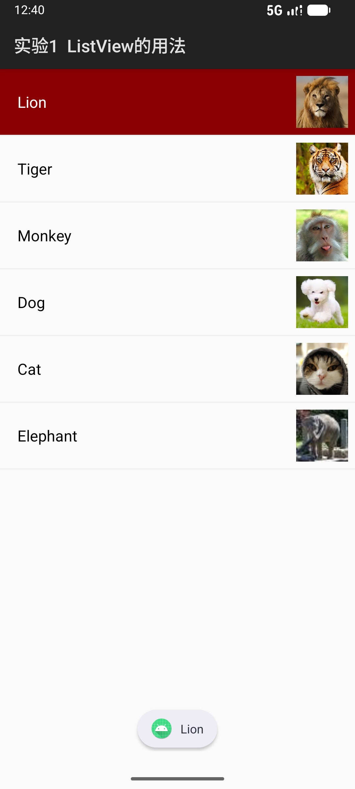
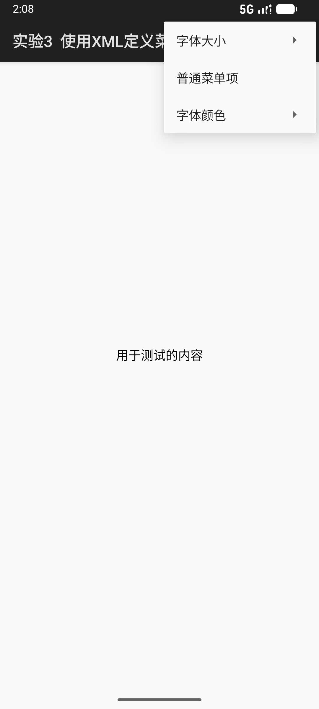
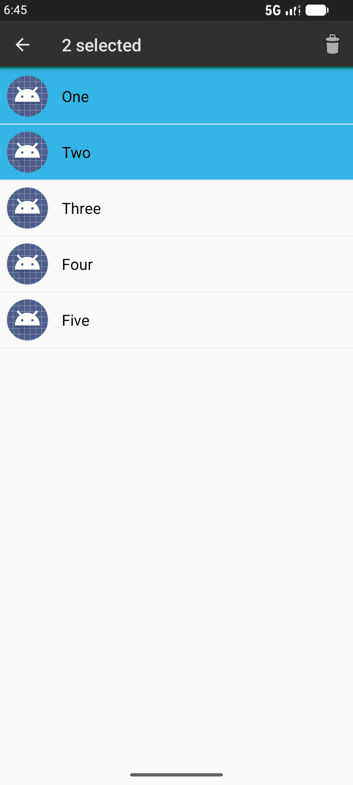
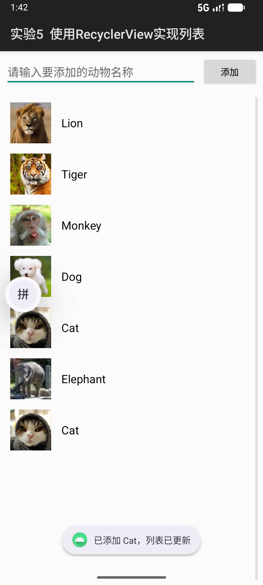

# Android 界面组件实验报告

## 一、实验目的


1. 掌握 Android 常用界面组件的基本用法：ListView、SimpleAdapter、RecyclerView、AlertDialog、菜单与 ActionMode 上下文操作模式

2. 学会通过自定义布局与适配器构建列表界面，正确处理列表项的单击、长按等交互事件

3. 掌握 Toast 提示与系统通知（Notification）的发送方法，理解二者在交互反馈中的区别与使用场景

4. 学会使用 XML 定义选项菜单，并完成菜单点击事件的分发处理

5. 掌握 RecyclerView + Adapter + ViewHolder 的列表实现方式，理解数据更新后列表的即时刷新机制

## 二、实验环境


| 项目     | 说明                                 |
| ------ | ---------------------------------- |
| 操作系统   | Windows                            |
| 开发工具   | Android Studio                     |
| 编程语言   | Kotlin                             |
| 构建系统   | Gradle（Kotlin DSL）                 |
| SDK 版本 | minSdk 24，compileSdk 37            |
| 运行设备   | Android 模拟器 Medium Phone（API 37.1） |
| 项目名称   | Component                          |

## 三、实验内容


1. 利用 SimpleAdapter 实现 ListView 列表：列表项包含动物图片与名称，单击列表项用 Toast 显示名称，并发送一条通知（图标为应用程序图标，Title 为列表项内容）

2. 创建自定义布局的 AlertDialog：顶部为 "ANDROID APP" 标题栏，含 Username、Password 输入框与 Cancel、Sign in 按钮，通过 setView () 挂载到对话框

3. 使用 XML 定义选项菜单：字体大小（小 / 中 / 大，对应 10/16/20 号字）、普通菜单项（Toast 提示）、字体颜色（红 / 黑）

4. 使用 ListView 创建 ActionMode 上下文操作模式：长按列表项进入操作栏，支持多选、计数显示与批量删除

5. 使用 RecyclerView + Adapter + ViewHolder 实现列表视图：列表项包含图片与名称，单击显示名称，增加记录后列表立即更新

## 四、实验步骤

### 1. 实验一：使用 ListView 实现动物列表

将 6 张动物图片（lion、tiger、monkey、dog、cat、elephant）复制到 `res/drawable` 目录，创建列表项布局 `listview_item.xml`（左侧 ImageView 显示图片，右侧 TextView 显示名称）。在主布局中放置 ListView，并使用 SimpleAdapter 将动物名称与图片绑定到列表项控件。

使用 SimpleAdapter 绑定数据：


```
val data = ArrayList<HashMap<String, Any>>()
for (i in animals.indices) {
    val map = HashMap<String, Any>()
    map["name"] = animals[i]
    map["image"] = images[i]
    data.add(map)
}
val adapter = SimpleAdapter(
    this, data, R.layout.listview_item,
    arrayOf("name", "image"),
    intArrayOf(R.id.item_name, R.id.item_image)
)
listView.adapter = adapter
```

为 ListView 设置单击事件：选中项背景切换为深红色（#8B0000）并显示白色文字，同时弹出只包含名字的 Toast，并发送通知（大图标为对应动物图片，标题为列表项内容）：


```
listView.onItemClickListener = AdapterView.OnItemClickListener { _, _, position, _ ->
    val name = animals[position]
    showNameToast(name)
    sendNotification(name, position)
    // 清除上一项背景，当前项变为深红背景 + 白字
}
```

运行效果：列表正常显示 6 种动物的图片与名称，单击后该项变为深红色高亮，底部弹出纯文字 Toast，下拉通知栏可查看对应动物的通知。




### 2. 实验二：创建自定义布局的 AlertDialog

创建自定义对话框布局 `dialog_custom.xml`：顶部为橙色（#FF9800）背景的 "ANDROID APP" 标题栏，中间为 Username、Password 两个输入框，底部右对齐排列 Cancel、Sign in 两个无边框按钮。

在 Activity 中通过 `AlertDialog.Builder` 的 `setView()` 方法将自定义布局挂载到对话框，并为布局内按钮绑定点击事件：


```
val builder = AlertDialog.Builder(this)
val dialogView = LayoutInflater.from(this).inflate(R.layout.dialog_custom, null)
builder.setView(dialogView)
val dialog = builder.create()
dialog.show()

dialogView.findViewById<Button>(R.id.dialog_signin).setOnClickListener {
    // 读取用户名与密码，Toast 回显，关闭对话框
}
```

运行效果：点击页面上的 "显示自定义对话框" 按钮，弹出登录对话框，可输入用户名与密码，点击 Sign in 回显输入内容，点击 Cancel 提示 "取消登录"。


### 3. 实验三：使用 XML 定义菜单

创建菜单资源 `menu_main.xml`，包含三个菜单项："字体大小"（嵌套小 / 中 / 大子菜单）、"普通菜单项"、"字体颜色"（嵌套红色 / 黑色子菜单）。

在 Activity 中重写 `onCreateOptionsMenu` 加载菜单，并在 `onOptionsItemSelected` 中根据菜单项 id 分发事件：


```
override fun onCreateOptionsMenu(menu: Menu): Boolean {
    menuInflater.inflate(R.menu.menu_main, menu)
    return true
}

override fun onOptionsItemSelected(item: MenuItem): Boolean {
    return when (item.itemId) {
        R.id.font_small   -> { tvTest.textSize = 10f; true }
        R.id.font_medium  -> { tvTest.textSize = 16f; true }
        R.id.font_large   -> { tvTest.textSize = 20f; true }
        R.id.menu_normal  -> { Toast.makeText(this, "你点击了普通菜单项", Toast.LENGTH_SHORT).show(); true }
        R.id.color_red    -> { tvTest.setTextColor(Color.RED); true }
        R.id.color_black  -> { tvTest.setTextColor(Color.BLACK); true }
        else -> super.onOptionsItemSelected(item)
    }
}
```

运行效果：点击右上角菜单按钮弹出菜单，展开 "字体大小" 可将测试文本切换为 10/16/20 号字，点击 "普通菜单项" 弹出 Toast，点击 "字体颜色" 可将文字切换为红色或黑色。



### 4. 实验四：创建 ActionMode 上下文菜单

创建列表项背景选择器 `actionmode_item_selector.xml`，使列表项在选中（state\_activated /state\_checked）时显示蓝色（#33B5E5）背景；创建 ActionMode 菜单 `menu_context.xml`，包含一个删除图标项。

在 Activity 中为 ListView 设置多选模态模式并实现 `MultiChoiceModeListener`：


```
listView.choiceMode = ListView.CHOICE_MODE_MULTIPLE_MODAL
listView.setMultiChoiceModeListener(object : AbsListView.MultiChoiceModeListener {
    override fun onItemCheckedStateChanged(
        mode: ActionMode, position: Int, id: Long, checked: Boolean
    ) {
        mode.title = "${listView.checkedItemCount} selected"
    }
    override fun onCreateActionMode(mode: ActionMode, menu: Menu): Boolean {
        mode.menuInflater.inflate(R.menu.menu_context, menu)
        mode.title = "${listView.checkedItemCount} selected"
        return true
    }
    // onActionItemClicked 中实现批量删除
})
```

运行效果：列表显示 One～Five 五项，长按任意一项进入 ActionMode 操作栏，选中项变蓝并显示 "1 selected"；可继续点选多项实时更新计数，点击删除图标后选中条目被移除，列表刷新。




### 5. 实验五：使用 RecyclerView 实现列表

在主布局中放置 RecyclerView，创建列表项布局 `recyclerview_item.xml`（图片 + 名称），编写继承 `RecyclerView.Adapter` 的适配器，内部使用 ViewHolder 缓存列表项控件：


```
private class AnimalAdapter(private val items: MutableList<Animal>) :
    RecyclerView.Adapter<AnimalAdapter.VH>() {

    class VH(itemView: View) : RecyclerView.ViewHolder(itemView) {
        val image: ImageView = itemView.findViewById(R.id.rv_image)
        val name: TextView  = itemView.findViewById(R.id.rv_name)
    }

    override fun onCreateViewHolder(parent: ViewGroup, viewType: Int): VH {
        val view = LayoutInflater.from(parent.context)
            .inflate(R.layout.recyclerview_item, parent, false)
        return VH(view)
    }

    override fun onBindViewHolder(holder: VH, position: Int) {
        val animal = items[position]
        holder.image.setImageResource(animal.imageRes)
        holder.name.text = animal.name
        holder.itemView.setOnClickListener { /* Toast 显示名称 */ }
    }

    override fun getItemCount(): Int = items.size
}
```

为 "添加" 按钮设置监听：读取输入框中的动物名称，按名称匹配对应图片后加入数据源，并调用 `notifyItemInserted` 立即刷新列表：


```
findViewById<Button>(R.id.btn_add).setOnClickListener {
    val name = et.text.toString().trim()
    val image = animalImageFor(name)   // 按名字匹配动物图片
    data.add(Animal(name, image))
    adapter.notifyItemInserted(data.size - 1)
    et.text.clear()
}
```

运行效果：列表初始显示 6 种动物的图片与名称，点击任意一项弹出名称 Toast；在输入框输入动物英文名（如 Cat）并点击添加，列表末尾立即出现新条目且图片与名字对应，滚动正常、更新后无错位。




## 五、实验结果


1. 实验一完成：ListView + SimpleAdapter 列表显示正常，单击选中项变深红高亮，Toast 只显示名字，通知带对应动物大图标与列表项标题

2. 实验二完成：自定义 AlertDialog 可正常弹出，包含 ANDROID APP 标题、Username/Password 输入框与 Cancel/Sign in 按钮，按钮事件生效

3. 实验三完成：XML 菜单可正常弹出，字体大小切换、普通菜单项 Toast、字体颜色切换均生效

4. 实验四完成：长按列表项进入 ActionMode 操作栏，多选蓝色高亮、计数实时更新，批量删除功能正常

5. 实验五完成：RecyclerView 列表显示、滚动正常，单击显示名称，添加记录后列表立即更新且图片与名称正确匹配

## 六、实验总结

本次实验完整实现了 Android 五种界面组件场景：ListView + SimpleAdapter 的列表展示与选中态切换、自定义布局 AlertDialog、XML 选项菜单、ListView + ActionMode 上下文操作模式，以及 RecyclerView + Adapter + ViewHolder 的高性能列表。

通过实验掌握了以下要点：


1. SimpleAdapter 适用于 "多字段映射" 的简单列表，通过 HashMap 与布局控件 id 建立数据到视图的映射；

2. 自定义对话框的关键在于 setView () 挂载布局，布局内按钮的事件需在布局中自行绑定；

3. XML 菜单通过 menuInflater.inflate () 加载，点击事件统一在 onOptionsItemSelected 中按 id 分发；

4. ActionMode 通过 CHOICE\_MODE\_MULTIPLE\_MODAL + MultiChoiceModeListener 实现长按多选与批量删除，选中态通过 state\_activated 选择器着色；

5. RecyclerView 需要手动编写 Adapter 与 ViewHolder，数据变更后调用 notifyItemInserted /notifyDataSetChanged 即时刷新，性能与可扩展性优于 ListView；

6. 交互反馈要注意 Toast（轻量提示）与 Notification（常驻消息中心）的区别与适用场景，并适配高版本系统的运行时权限要求。